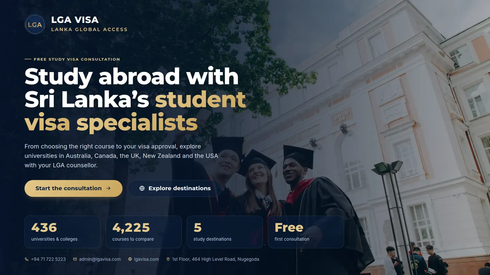
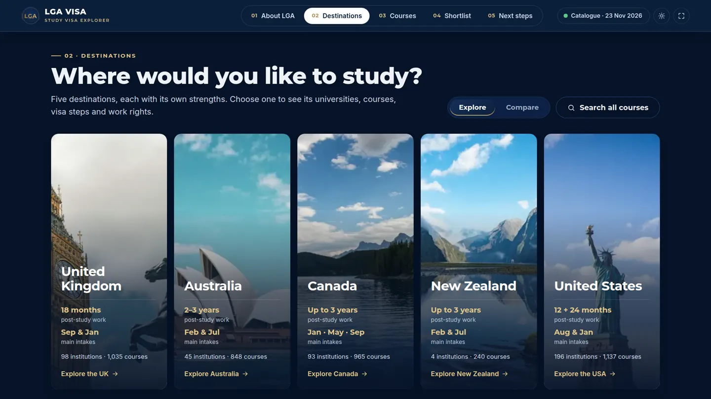
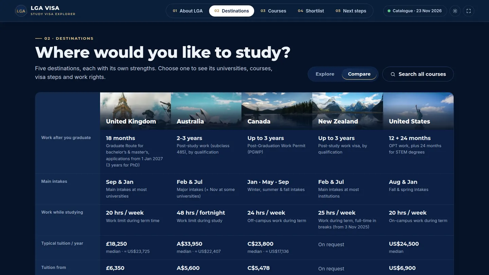
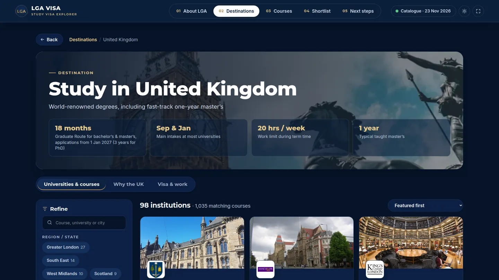
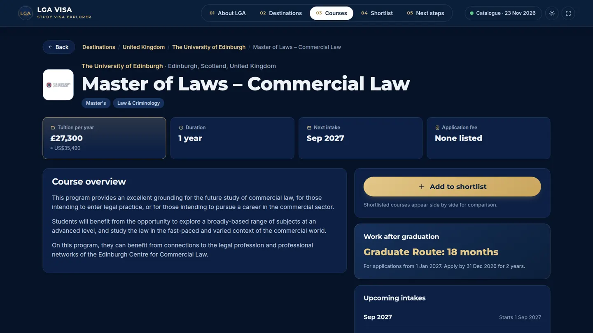
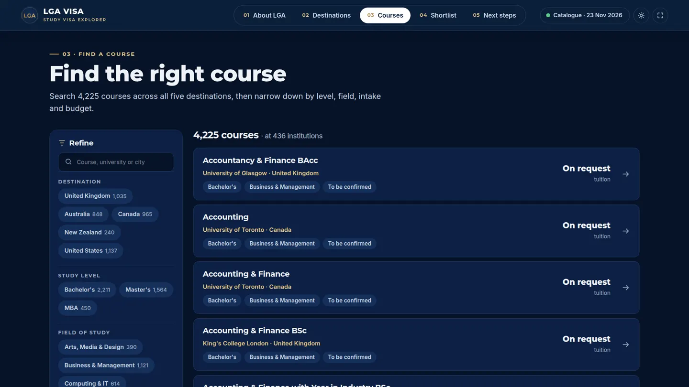
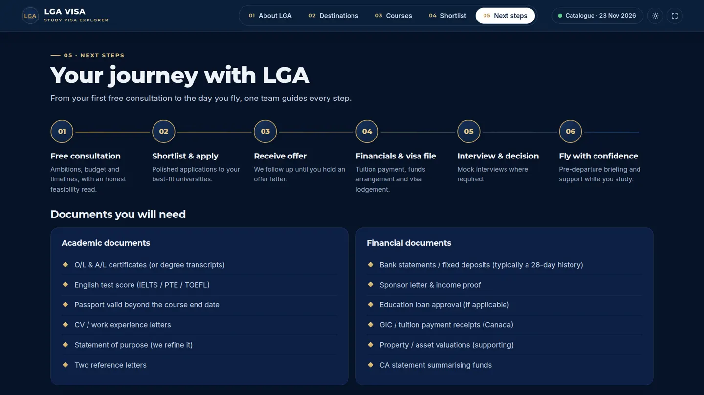
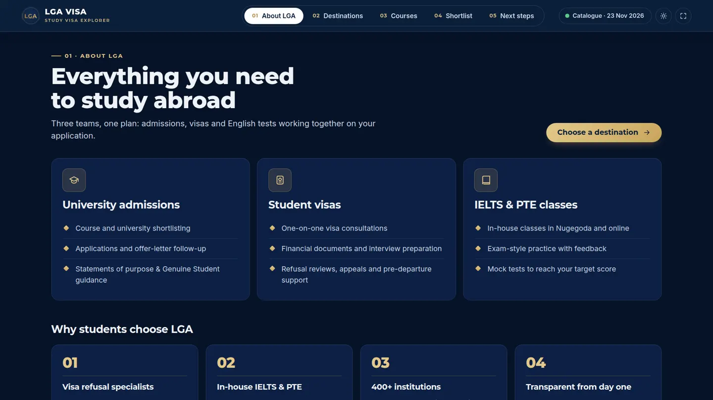
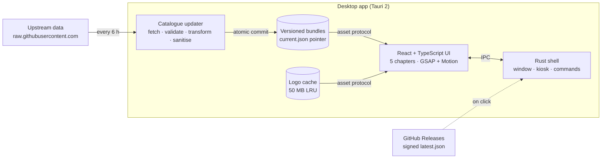

<div align="center">


# LGA Study Visa Explorer

**The study-visa consultation, presented.**
A full-screen desktop app LGA Visa consultants use to walk students and parents through destinations,
universities, courses, visas and work rights — on the big office screen, online or offline.

[](https://github.com/charithmadhuranga/lga-study-visa-explorer/actions/workflows/ci.yml)
[](https://github.com/charithmadhuranga/lga-study-visa-explorer/releases/latest)
[](LICENSE)
[](#download--install)

[](https://tauri.app)
[](https://www.rust-lang.org)
[](https://react.dev)
[](https://www.typescriptlang.org)
[](https://tailwindcss.com)
[](#offline-first-by-design)

[Features](#features) · [Screenshots](#screenshots) · [Download](#download--install) · [Development](#development) · [Architecture](#architecture) · [License](#license--commercial-use)

<br />



</div>

---

## Why it exists

A study-visa consultation used to run on a PDF deck, a website and the consultant's memory.
**LGA Study Visa Explorer replaces the deck.** It is organised as a five-chapter pitch the
consultant drives by hand while talking — and every number on screen comes from a live,
dated course catalogue, so nothing is out of date or made up.

| | |
|---|---|
| **436** universities & colleges | **4,225** courses with fees, durations and intakes |
| **5** destinations — UK, Australia, Canada, New Zealand, USA | **0** network needed during a consultation |

## Features

**A consultation in five chapters** — `01 About LGA` → `02 Destinations` → `03 Find a course` →
`04 Shortlist` → `05 Next steps`. Every chapter opens like a slide; a presentation clicker
(PageUp / PageDown) moves between them.

- 🌏 **Destinations, side by side** — photo cards to choose from, and a *Compare* view of
  post-study work rights, intakes, work hours and typical tuition (in local currency and US$).
- 🏛️ **Country, university and course pages** — visa steps as a timeline, FAQs revealed on cue,
  campus facts, course overviews, upcoming intakes and work-after-graduation rules.
- 🔎 **Course finder** — search all 4,225 courses by destination, level, field, intake, budget
  (compared in US$), scholarships and co-op.
- ⭐ **Shortlist** — compare chosen courses side by side and copy a summary straight into
  WhatsApp or email.
- 🔄 **Always current** — the catalogue updates itself in the background from LGA's data
  pipeline, with a status chip showing exactly how fresh it is. Signed app updates install
  only when a consultant clicks.
- 🔒 **Private by design** — after 4 minutes of inactivity the screen resets for the next
  visitor. The shortlist and filters are never written to disk.
- 🖥️ **Built for the room** — full-screen, readable from 4 m, dark and light themes,
  reduced-motion support, and a locked `--kiosk` mode for unattended screens.

## Screenshots

<table>
  <tr>
    <td width="50%"><br /><sub><b>02 · Destinations</b> — choose a country</sub></td>
    <td width="50%"><br /><sub><b>Compare</b> — work rights, intakes and tuition side by side</sub></td>
  </tr>
  <tr>
    <td><br /><sub><b>Country</b> — key facts, universities, visa & work</sub></td>
    <td><br /><sub><b>Course</b> — tuition, intakes and work after graduation</sub></td>
  </tr>
  <tr>
    <td><br /><sub><b>03 · Find a course</b> — every course, every filter</sub></td>
    <td><br /><sub><b>05 · Next steps</b> — the process and a closing call to action</sub></td>
  </tr>
  <tr>
    <td colspan="2"><br /><sub><b>01 · About LGA</b> — admissions, visas and English tests under one roof</sub></td>
  </tr>
</table>

## Download & install

Installers are published on the [Releases](https://github.com/charithmadhuranga/lga-study-visa-explorer/releases) page.

| Platform | File | Updates itself |
|---|---|---|
| Windows 10 / 11 (x64) | `…_x64-setup.exe` | ✅ |
| macOS 12+ (Apple silicon / Intel) | `…_aarch64.dmg` / `…_x64.dmg` | ✅ |
| Linux (x64) | `….AppImage` (recommended) or `.deb` | ✅ AppImage · manual for `.deb` |

> macOS builds are not yet notarised: on first launch, right-click the app and choose **Open**.
> Setting up an office screen, kiosk mode or troubleshooting? See the **[operator guide](docs/OPERATOR-GUIDE.md)**.
> What changed: **[CHANGELOG](CHANGELOG.md)** · Release QA: **[acceptance record](docs/ACCEPTANCE.md)**.

**Using it in the office**

| Key | Action |
|---|---|
| `PageDown` / `PageUp` | next / previous chapter (presentation clickers send these) |
| `←` / `→` | previous / next course at the same university |
| `Esc` | back |
| `Home` | destinations |
| `F11` | toggle full screen |
| `Ctrl` / `⌘` + `Q` | quit |

Start with `--kiosk` to lock the app full-screen, on top, with the cursor hidden — only
`Ctrl`/`⌘`+`Q` exits.

## Offline first by design

The installer ships a complete catalogue snapshot, so every screen works with the network
unplugged. When online, the app checks for new catalogue data 8 seconds after launch and every
6 hours, downloads it in the background, validates and converts it, and swaps it in without a
restart. A failed or interrupted update never touches the data on screen. University logos
seen online are cached for offline use; anything else falls back to a crest with the
institution's initials.

## Development

**Prerequisites:** Node.js ≥ 20.19, Rust (stable), and the
[Tauri 2 system dependencies](https://v2.tauri.app/start/prerequisites/) for your OS
(on Ubuntu: `libwebkit2gtk-4.1-dev libayatana-appindicator3-dev librsvg2-dev patchelf libssl-dev`).

```bash
npm install
npm run tauri dev        # the desktop app (windowed in dev)
npm run dev              # browser only, against the bundled snapshot
```

| Task | Command |
|---|---|
| Type-check · lint · unit tests | `npm run typecheck && npm run lint && npm test` |
| End-to-end (Playwright, production build) | `npm run e2e` (Chromium) · `npm run e2e:all` (+ WebKit) |
| Rust checks | `cargo fmt --manifest-path src-tauri/Cargo.toml --check` · `cargo clippy --manifest-path src-tauri/Cargo.toml --all-targets -- -D warnings` · `cargo test --manifest-path src-tauri/Cargo.toml` |
| Rebuild the bundled snapshot | `npm run data:import` |
| Snapshot parity | `npm run data:parity` |
| Rust transform vs snapshot (record for record) | `LGA_UPSTREAM_DIR=/path/to/processed npm run data:parity:upstream` |
| Release build | `npm run tauri build` (signing key required — see the release guide) |

Every push and pull request runs the full check suite in
[CI](.github/workflows/ci.yml). Tagging `vX.Y.Z` builds signed installers for all platforms
into a draft release ([release workflow](.github/workflows/release.yml)).

## Architecture



| Path | What lives there |
|---|---|
| `src/` | React app — `screens/`, `components/`, `data/` (types, selectors, filters), `store/`, `styles/` (design tokens) |
| `src-tauri/src/` | Rust shell — `window.rs`, `commands.rs`, `catalogue/` (updater, transform, sanitiser, store, logo cache) |
| `src-tauri/tests/` | Upstream parity gate and opt-in live network tests |
| `scripts/` | Snapshot import and parity check |
| `public/data/` | Bundled catalogue snapshot |
| `reference/` | The original Electron mock — read-only baseline |

The full contract lives in [`SPEC.md`](SPEC.md) (requirements), [`DESIGN.md`](DESIGN.md)
(visual and motion system), [`PLAN.md`](PLAN.md) (milestones and status) and
[`AGENTS.md`](AGENTS.md) (rules for contributors).

## License & commercial use

**Copyright © 2026 Lanka Global Access (Private) Limited. All rights reserved.**

This repository is **source-available, not open source**. You may read the code and run it
privately for personal, non-commercial study or evaluation.

**Commercial use of any kind — including using it to provide consulting, admissions or visa
services, redistributing it, hosting it, or building on it — is prohibited without prior
written permission from Lanka Global Access (Private) Limited.**

See [`LICENSE`](LICENSE) for the full terms. To request a commercial licence, contact
**admin@lgavisa.com**.

### Third-party material

University and institution names, logos, descriptions, course data and photographs belong to
their respective owners and are not covered by the licence above. Open-source dependencies and
fonts (Montserrat and Inter, SIL Open Font License) remain under their own licences.

---

<div align="center">
<sub><b>LGA Visa</b> · Lanka Global Access (Pvt) Ltd · 1st Floor, 464 High Level Road, Nugegoda, Sri Lanka · <a href="https://lgavisa.com">lgavisa.com</a></sub>
</div>
